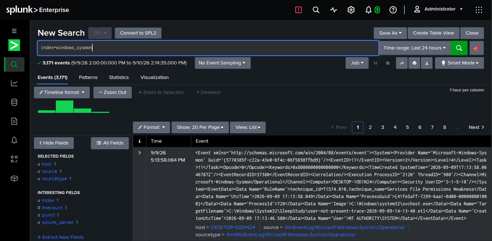
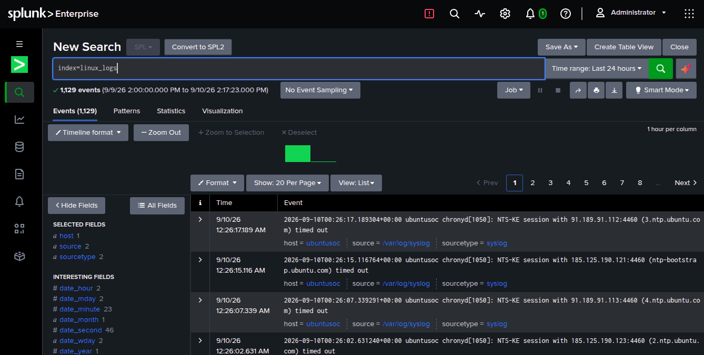

# SOC Home Lab: Splunk + Sysmon on Windows and Linux

A working SIEM pipeline built end to end: two endpoints (Ubuntu Server and Windows 10) ship real telemetry to a Dockerized Splunk indexer through the Splunk Universal Forwarder. It is the log foundation for my next portfolio projects (attack simulation, detections, DFIR).

## Demo

| Windows (Sysmon) | Linux (syslog + auth.log) |
|---|---|
|  |  |

Architecture diagram: [`diagrams/architecture.png`](diagrams/architecture.png)

## Architecture

```
┌──────────────────────────┐         ┌────────────────────────────┐
│   Ubuntu Server VM       │         │      Windows 10 VM         │
│  /var/log/syslog         │         │  Sysmon (sysmon-modular    │
│  /var/log/auth.log       │         │  config by Olaf Hartong)   │
│  Splunk Universal Fwd    │         │  Splunk Universal Fwd      │
└───────────┬──────────────┘         └─────────────┬──────────────┘
            │  tcp/9997 (host-only network)        │  tcp/9997 (renderXml=true)
            └────────────────┬─────────────────────┘
                             ▼
                 ┌───────────────────────────┐
                 │  Host: Splunk (Docker)    │
                 │  192.168.56.1             │
                 │  index: linux_logs        │
                 │  index: windows_sysmon    │
                 └───────────────────────────┘
```

VirtualBox host-only network (`192.168.56.0/24`) connects both VMs to the host running the indexer.

## Results

Verifiable in the screenshots above (24-hour window, 9–10 Sep 2026):

| Index | Source | Events |
|---|---|---|
| `windows_sysmon` | `XmlWinEventLog:Microsoft-Windows-Sysmon/Operational` | 3,171 |
| `linux_logs` | `/var/log/syslog`, `/var/log/auth.log` | 1,129 |

Sysmon events arrive already tagged with ATT&CK technique IDs by the sysmon-modular config (e.g. `technique_id=T1574.010` in the Windows screenshot).

## How to run

Indexer (host):

```bash
cp .env.example .env        # then set a strong SPLUNK_PASSWORD
docker compose up -d
# open http://127.0.0.1:8000  (user: admin)
```

Forwarders: install the Splunk Universal Forwarder on each VM and copy the matching files from [`configs/`](configs/) into `$SPLUNK_HOME/etc/system/local/`:

| VM | Files |
|---|---|
| Ubuntu Server | [`configs/ubuntu_forwarder/`](configs/ubuntu_forwarder/) |
| Windows 10 | [`configs/windows_forwarder/`](configs/windows_forwarder/) — install Sysmon first: `sysmon64.exe -accepteula -i sysmonconfig.xml` |

> In the forwarder installer, leave **Deployment Server** (8089, management plane) empty. The field that matters is **Receiving Indexer** (9997, data plane).

### Verification

```spl
index=_internal                                           ``` indexer is up ```
index=_internal sourcetype=splunkd component=TcpInputProc ``` forwarder connected ```
index=linux_logs                                          ``` Linux events ```
index=windows_sysmon                                      ``` Sysmon events ```
```

Network check before waiting for data:

```bash
nc -zv 192.168.56.1 9997                                   # from the Ubuntu VM
```
```powershell
Test-NetConnection -ComputerName 192.168.56.1 -Port 9997   # from the Windows VM
```

## Troubleshooting

| Symptom | Cause | Fix |
|---|---|---|
| Forwarder installs but no data arrives | Missing `outputs.conf` | Silent failure: create the file manually |
| Forwarder running, still no data | Port 9997 receiving not enabled | `SPLUNK_ENABLE_LISTEN=9997` in compose, or *Settings → Forwarding and receiving* |
| Log path not found | `/var/logs/` instead of `/var/log/` | Check the exact path |
| `disable = true` ignored | The key is `disabled` | Fix the key name |
| `outputs.conf` sends nothing | `default-Group` instead of `defaultGroup`, or `tcp-server://` instead of `tcpout-server://` | Check exact casing of keys and stanzas |

## Security fixes

| Issue (first version) | Risk | Fix |
|---|---|---|
| `SPLUNK_PASSWORD={SPLUNK_PASSWORD}`: missing `$`, so the admin password was the literal string `{SPLUNK_PASSWORD}` | Predictable admin password on a web UI exposed on all interfaces | `${SPLUNK_PASSWORD:?…}` read from a git-ignored `.env`; compose refuses to start without it |
| Splunk Web published on `0.0.0.0:8000` | Admin UI reachable from the LAN | Bound to `127.0.0.1:8000` |
| `splunk/splunk:latest` | Non-reproducible lab, surprise upgrades | Pinned to `10.2` |
| Windows forwarder config files were empty | Repo did not match the documented setup | Filled with the config used in the lab |

## Design decisions and limitations

- **Docker for the indexer, VMs for endpoints:** the indexer is disposable and versioned in compose; endpoints need a real OS to produce real telemetry.
- **Separate indexes per OS** keep searches fast and retention configurable per source.
- **`renderXml = true`** for Sysmon so every field is extracted reliably.
- Limitations: single-node indexer, no TLS between forwarders and indexer, no saved searches or alerts yet. This lab covers ingestion only.

## What I learned

- The forwarder installer has two easy-to-confuse fields: **Deployment Server** (8089) and **Receiving Indexer** (9997). Only the second matters in a single-node lab.
- Receiving on 9997 is **not enabled by default** in Splunk.
- A missing `outputs.conf` is a silent failure: everything looks installed but nothing is sent.
- Typos in `.conf` files rarely raise clear errors; exact casing (`defaultGroup`, `tcpout-server://`) matters.
- Debug in order: indexer up → network → data source (Sysmon) → `index=_internal` to confirm the forwarder.

## With more time

- Simulate attacks (Atomic Red Team) and write SPL detections with screenshots of true positives.
- Turn those detections into Sigma rules (planned in `detections-as-code`).
- Add TLS between forwarders and indexer.
- Run Wazuh side by side to compare Splunk with a fully open-source SIEM.

## License

[MIT](LICENSE)
